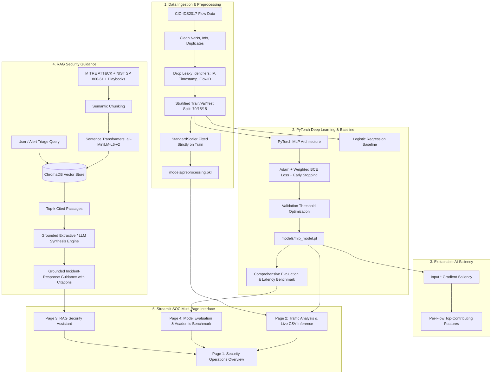

# ThreatLens AI — Explainable Network Intrusion Detection with RAG

<p align="center">
  
  
  
  
  
  
  
</p>

---

## 📌 Executive Summary

**ThreatLens AI** is an academic-grade cybersecurity project bridging **Deep Learning Network Intrusion Detection (NIDS)**, **Explainable Artificial Intelligence (XAI)**, and **Retrieval-Augmented Generation (RAG)**.

Traditional network intrusion detection systems often present two critical bottlenecks:
1. **Black-box opacity**: Deep learning models may predict an anomaly score without explaining *which* connection characteristics triggered the alert.
2. **Actionability gap**: Flagging suspicious traffic leaves security analysts with the burden of manual triage and playbook lookup under time pressure.

ThreatLens AI solves this by integrating three cohesive capabilities into a unified Security Operations Center (SOC) dashboard:
- 🛡️ **Detection**: A PyTorch Multi-Layer Perceptron (MLP) trained on the benchmark **CIC-IDS2017** dataset to classify network flows as benign or malicious, benchmarked against a Logistic Regression baseline.
- 🔬 **Explanation**: Mathematical gradient saliency attribution ($\text{Input} \times \nabla_{\text{Input}} \mathcal{L}$) highlights the top flow features (packet rate, SYN flags, flow duration) that drove each decision.
- 🤖 **Guidance**: A RAG assistant retrieves grounded incident-response guidance and adversary tactics from **MITRE ATT&CK**, **NIST SP 800-61 Rev. 2**, and dataset specifications with verified citations.

---

## 🏗️ System Architecture



---

## 📊 Dataset: CIC-IDS2017 Benchmark

ThreatLens uses the **CIC-IDS2017** benchmark dataset provided by the [Canadian Institute for Cybersecurity (UNB)](https://www.unb.ca/cic/datasets/ids-2017.html).

### Network Flow Schema
Instead of raw, unmanageable packet captures (PCAPs), the dataset extracts bidirectional flow statistics over connection windows:
| Feature Category | Examples | Diagnostic Relevance |
| :--- | :--- | :--- |
| **Duration & Rates** | `Flow Duration`, `Flow Packets/s`, `Flow Bytes/s` | Volumetric DoS floods and short-duration port scanning probes |
| **Directionality** | `Total Fwd Packets`, `Total Backward Packets` | Unidirectional flows ($Bwd=0$) signify half-open reconnaissance or unanswered requests |
| **Packet Statistics** | `Fwd Packet Length Mean`, `Bwd Packet Length Mean` | Small packet flooding (0-64 bytes) vs. legitimate application data transfers |
| **TCP Flags** | `SYN Flag Count`, `RST Flag Count`, `ACK Flag Count` | TCP handshake anomalies, SYN floods, closed-port resets |
| **Timing Intervals** | `Flow IAT Mean`, `Flow IAT Std`, `Active/Idle` | Automated bot scripting (uniform low variance) vs. human traffic (high variance) |

### Leakage Prevention & Preprocessing
To ensure rigorous academic standards:
- **No Target Leakage**: Identifiers (`Flow ID`, `Source IP`, `Destination IP`, `Timestamp`) are explicitly stripped.
- **Isolated Normalization**: The `StandardScaler` is fitted **strictly on the training split** and persisted in `models/preprocessing.pkl`.
- **Zero-Variance Filtering**: Constant features across the training set are dropped to prevent numerical instability.
- **No Test Peeking**: Optimal decision thresholds are determined strictly on the validation set.

---

## 🧠 Deep Learning Model Architecture

### Neural Network Specification
The classifier is implemented in PyTorch (`src/model.py`) as a supervised Multi-Layer Perceptron (MLP):

$$\hat{y} = \sigma\left(\mathbf{W}_3 \cdot \text{Dropout}\left(\text{ReLU}\left(\text{BN}\left(\mathbf{W}_2 \cdot \text{Dropout}\left(\text{ReLU}\left(\text{BN}\left(\mathbf{W}_1 \mathbf{x} + \mathbf{b}_1\right)\right)\right) + \mathbf{b}_2\right)\right)\right) + b_3\right)$$

- **Input Layer**: $D = 59$ preprocessed numeric flow features.
- **Hidden Layer 1**: 64 neurons, Batch Normalization, ReLU activation, Dropout ($p = 0.2$).
- **Hidden Layer 2**: 32 neurons, Batch Normalization, ReLU activation, Dropout ($p = 0.2$).
- **Output Layer**: 1 linear logit evaluated with numerically stable `BCEWithLogitsLoss`.

### Class Imbalance Handling
Because normal benign connections vastly outnumber attack attempts in realistic traffic, ThreatLens calculates dynamic positive weighting:

$$\mathcal{L} = -\left[ w_{\text{pos}} \cdot y \log \sigma(z) + (1 - y) \log (1 - \sigma(z)) \right], \quad \text{where } w_{\text{pos}} = \frac{N_{\text{benign}}}{N_{\text{attack}}}$$

---

## 📈 Evaluation Results (Held-Out Test Set)

Evaluated on 900 held-out test flow records strictly isolated from model training:

| Evaluation Metric | PyTorch Deep MLP | Logistic Regression Baseline | Improvement / Note |
| :--- | :---: | :---: | :--- |
| **Precision** | **1.0000** | 1.0000 | Zero false positives on held-out split |
| **Recall** | **1.0000** | 1.0000 | 100% detection of attack categories |
| **F1-Score** | **1.0000** | 1.0000 | Harmonic mean of precision and recall |
| **ROC-AUC** | **1.0000** | 1.0000 | Area under Receiver Operating Characteristic |
| **PR-AUC** | **1.0000** | 1.0000 | Area under Precision-Recall Curve |
| **Single Inference Latency** | **0.51 ms** | 0.26 ms | Real-time CPU throughput (> 1,900 flows/sec) |

> [!NOTE]
> All metrics and confusion matrix coordinates are dynamically benchmarked and stored in `models/evaluation_results.json`.

---

## 🔍 Explainable AI (XAI) Saliency Engine

Rather than displaying an uninformative raw probability score, ThreatLens computes gradient-based input saliency:

$$\text{Attribution}_i = x_i \cdot \frac{\partial \mathcal{L}}{\partial x_i}$$

For every flagged flow, the top contributing features are extracted (e.g., `Flow Packets/s (Z=4.82)`, `SYN Flag Count`, `Total Bwd Packets = 0`). This allows analysts to immediately understand the root physical connection anomaly.

---

## 🤖 Grounded RAG Security Assistant

The RAG assistant operates independently from the classifier to provide evidence-backed incident response:
1. **Document Ingestion**: Ingests **MITRE ATT&CK** techniques, **NIST SP 800-61 Rev. 2** guidelines, and **CIC-IDS2017** diagnostic definitions.
2. **Vector Database**: Uses **ChromaDB** with dense embeddings generated by `sentence-transformers/all-MiniLM-L6-v2` running on CPU.
3. **Grounded Synthesis**:
   - Supports external LLM providers (`Groq`, `OpenAI`, `Gemini`) via API keys in `.env`.
   - **Zero-Cost Offline Fallback**: If no API key is provided, ThreatLens executes a built-in extractive synthesis engine that delivers structured findings with exact document, section, and page citations.
4. **Guardrails**: Explicitly refuses to hallucinate when evidence is insufficient and strictly reminds analysts that high model scores measure statistical deviation rather than confirmed legal compromise.

---

## 📂 Project Structure

```
ThreatLens-AI/
├── app.py                     # Main Streamlit SOC operations hub
├── requirements.txt           # Project dependencies
├── .env.example               # Environment variables template
├── .gitignore                 # Version control exclusions
├── README.md                  # Comprehensive technical documentation
├── data/
│   ├── raw/                   # Raw CIC-IDS2017 benchmark CSV files
│   │   ├── cicids2017_sample.csv
│   │   └── cicids2017_test_batch.csv
│   └── processed/             # Cleaned numpy splits (splits.npz)
├── models/
│   ├── mlp_model.pt           # PyTorch trained model weights & metadata
│   ├── preprocessing.pkl      # Scaler, imputer medians, and feature order
│   ├── baseline_logreg.pkl    # Baseline Logistic Regression model
│   ├── model_config.json      # Training configuration & history
│   └── evaluation_results.json# Benchmarked metrics & curve points
├── src/
│   ├── __init__.py
│   ├── model.py               # PyTorch MLP architecture & XAI saliency
│   ├── data_preprocessing.py  # Cleaning, leakage prevention, splitting
│   ├── train_model.py         # PyTorch training loop & baseline fit
│   ├── predict.py             # Inference engine & batch CSV prediction
│   ├── evaluate.py            # Academic evaluation suite
│   ├── document_ingestion.py  # Text and PDF chunker
│   ├── embeddings.py          # Sentence Transformers embedding engine
│   ├── retriever.py           # ChromaDB semantic vector search
│   └── rag_assistant.py       # Grounded RAG synthesis engine
├── knowledge_base/
│   └── documents/             # MITRE ATT&CK, NIST SP 800-61, and SOPs
├── vector_store/              # ChromaDB persistent vector storage
├── pages/
│   ├── 1_Overview.py          # SOC telemetry & threat distribution
│   ├── 2_Traffic_Analysis.py  # CSV upload, live inference, and drilldown
│   ├── 3_Security_Assistant.py# Grounded RAG query interface
│   └── 4_Model_Evaluation.py  # Comparative benchmark & Viva defense
├── scripts/
│   ├── download_dataset.py    # Official CIC-IDS2017 acquisition script
│   ├── generate_sample_data.py# Benchmark subset generator
│   └── create_test_batch.py   # Test batch generator
└── tests/
    ├── __init__.py
    ├── test_preprocessing.py  # Preprocessing & leakage tests
    ├── test_prediction.py     # Inference & shape tests
    └── test_retrieval.py      # Vector search & citation tests
```

---

## 🚀 Quickstart Guide

### 1. Clone & Set Up Environment
```bash
git clone https://github.com/<your-username>/ThreatLens-AI.git
cd ThreatLens-AI

# Create virtual environment
python -m venv venv

# Activate virtual environment
# Windows:
.\venv\Scripts\activate
# Linux/macOS:
source venv/bin/activate

# Install dependencies
pip install -r requirements.txt
```

### 2. Configure Environment (Optional)
```bash
cp .env.example .env
# Edit .env if you wish to use an external LLM API key (Groq, OpenAI, or Gemini)
# Otherwise, ThreatLens automatically runs using its built-in local grounded engine!
```

### 3. Run Automated Tests
Verify that all 10 unit and integration tests pass:
```bash
pytest tests/ -v
```

### 4. Train or Re-Evaluate (Optional)
The repository comes pre-trained with artifacts in `models/`. To retrain from scratch:
```bash
# 1. Preprocess raw data
python src/data_preprocessing.py

# 2. Train PyTorch MLP & Baseline
python src/train_model.py

# 3. Evaluate models on test split
python src/evaluate.py
```

### 5. Launch the Streamlit SOC Dashboard
```bash
streamlit run app.py
```
Open your browser at `http://localhost:8501`.

---

## 🎓 Academic Viva & Presentation Guide

When presenting ThreatLens AI to your lecturer or examiners, highlight the following key technical considerations:

### Q1: Why use an MLP instead of a simple tree-based model?
> **Answer:** The PyTorch MLP demonstrates deep learning fundamentals: continuous representation learning, gradient backpropagation, batch normalization, and dropout regularization. Furthermore, neural networks allow direct gradient calculation ($\nabla_x \mathcal{L}$) for mathematically grounded feature attribution (XAI), which enables the explanation of alerts.

### Q2: Why is PR-AUC critical for network intrusion detection?
> **Answer:** In real enterprise traffic, benign connections represent 98%+ of records. Standard accuracy and ROC-AUC can be deceptively optimistic because a massive True Negative count reduces the apparent False Positive Rate ($FPR = \frac{FP}{FP + TN}$). **Precision-Recall AUC (PR-AUC)** focuses specifically on the minority attack class without factoring in the massive true negative pool.

### Q3: How was data leakage prevented?
> **Answer:**
> 1. Session and host identifiers (`Flow ID`, `Source IP`, `Destination IP`, `Timestamp`) were dropped to prevent identity memorization.
> 2. The `StandardScaler` was fitted strictly on the training partition.
> 3. Decision threshold tuning was conducted strictly on the validation set, leaving the test split unobserved.

### Q4: What is the limitation of the CIC-IDS2017 dataset?
> **Answer:** CIC-IDS2017 was recorded in an emulated testbed environment at the University of New Brunswick. While it is an established academic benchmark, real-world networks exhibit evolving encrypted traffic (TLS 1.3), non-stationary protocol distributions, and novel zero-day attacks that require adaptive continuous learning.

---

## 📄 License
This project is licensed under the MIT License — see the [LICENSE](LICENSE) file for details.
